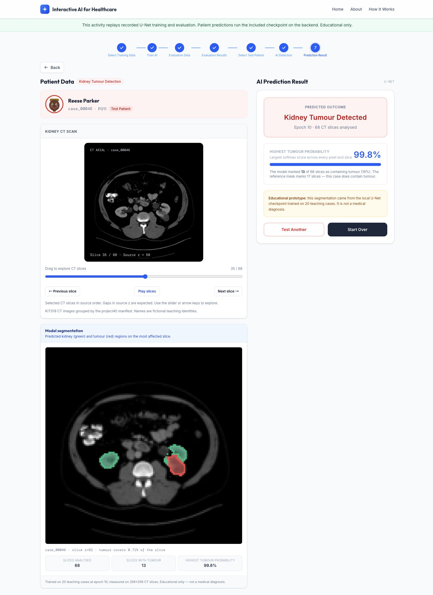

# 医疗 AI 互动教育平台 · 02_main 完整版

此仓库当前版本来自 **`02_main` 项目**，已替换之前误上传的仅糖尿病版本。包含 React 前端、Python 后端、糖尿病随机森林、肾脏教学 U-Net **源码与已训练权重**，以及 40 名教学患者的资料。

项目来源：UNSW COMP9900（2026 T3）P02，团队 **9900-H18J-DONUT**。保留原团队文档和数据来源，不代表独立完成整个小组项目。

## 下载完整项目

- **推荐：** [下载 02_main 完整包](https://github.com/minatolog/ai-healthcare-education/releases/download/02-main-v1/02_main-complete.zip)，解压后同时拥有源码、肾脏权重、3,757 张 CT 和 3,757 张参考掩码。
- **使用 Git：** 克隆仓库后，按下面步骤安装依赖，再运行 `python scripts/prepare_data.py`。该命令从同仓库 Release 下载 CT/掩码，并校验压缩包和每张图像的 SHA-256。现有数据完整时不会重复下载。

肾脏权重 `artifacts/kidney/kidney_unet.pt` 和评估记录直接包含在源码仓库中。体积较大的 CT/掩码放在版本固定的 Release 附件；源码 ZIP 本身不包含这 7,514 张 PNG。

## 当前能做什么

| 模块 | 实际行为 |
| --- | --- |
| 患者浏览 | 两个模块各展示 40 个教学身份，查看临床数值或 CT 切片 |
| 糖尿病 | 选择前 30 人中的 20 人，后端真实训练随机森林；其余 10 人用于验证选择树的数量，P031–P040 固定为最终测试/预测组 |
| 糖尿病解释 | 显示模型分数、全局特征重要性和单特征参考替换带来的分数变化 |
| 肾脏训练页 | 读取已训练 U-Net 的真实历史与评估记录，**不在网页中重新训练** |
| 肾脏评估页 | 展示该权重对应的 10 名测试患者及已保存 Dice 报告，动画只用于阅读展示 |
| 肾脏预测 | 后端加载现有权重，真实分割所选测试患者的 CT，生成肾脏/肿瘤叠加图 |

网页保留蓝白风格和英文文案，便于课堂演示。当前没有医学图像与临床信息的多模态融合、用户账户、数据库或生产部署。

## 运行截图

下图来自本次 `02_main` 的真实肾脏推理与分割叠加图。



## 环境与安装

本次验证使用 **Python 3.12** 和 **Node.js 24（64 位）**。前端为 React 19、TypeScript、Vite 8、Tailwind；后端为 Python 标准库 HTTP 服务，模型依赖 scikit-learn 和 PyTorch。

在项目根目录执行：

```bash
python3 -m venv .venv
.venv/bin/python -m pip install -r requirements.txt
.venv/bin/python scripts/prepare_data.py
cd frontend
npx --yes pnpm@10 install --frozen-lockfile
cd ..
```

如果下载的是完整包，数据准备命令只校验本地 PNG，不会下载。

Windows PowerShell 中，使用 `py -3.12 -m venv .venv`，将 `.venv/bin/python` 替换为 `.\.venv\Scripts\python.exe`；其余 Python 命令参数相同。

## 启动前后端

macOS / Linux 开两个终端，均从项目根目录开始：

```bash
# 终端一：Python 后端，默认 8004
./run_backend.sh
```

```bash
# 终端二：React 前端，默认 8444
./run_frontend.sh
```

打开 [http://127.0.0.1:8444](http://127.0.0.1:8444)。如端口占用，运行 `./run_frontend.sh --port 8445` 并打开对应地址。停止时在相应终端按 `Ctrl+C`。

Windows：

```powershell
# 终端一
.\.venv\Scripts\python.exe backend/server.py --port 8004
# 终端二
cd frontend
npm run dev -- --host 127.0.0.1
```

前端默认将 `/api` 代理到 `http://127.0.0.1:8004`。如修改后端端口，启动前端前设置 `API_BASE_URL`。不需要 API Key 或数据库。首次依赖安装与 Git 版的数据准备需要联网，数据齐全后可本地运行。

## 肾脏模型说明

网站使用 `backend/kidney_web_model.py` 定义的 **SmallUNet**：单通道 128×128 输入，背景、肾脏、肿瘤三个输出类别。它和 `backend/kidney/` 中保留的 ResNet18/U-Net 研究流程是不同的实现；网站加载的是教学 SmallUNet 权重。

本次保留原有权重，没有重新训练或覆盖。附带记录显示：固定 20/10/10 病例分组，训练 12 个 epoch，按验证集肿瘤 Dice 选择 epoch 10；10 名测试患者的平均肾脏 Dice 为 **0.8543**、肿瘤 Dice 为 **0.4006**。这些是权重附带的历史评估记录，不是每次打开网页重新测得的成绩。

所有测试病例都含肿瘤，因此“是否发现肿瘤”的标签符合率不能当作有区分能力的检测准确率。预测中的最高 softmax 分数也不是校准后的患病概率。

如确实需要新实验，可使用新文件名，保留现有基线：

```bash
.venv/bin/python backend/train_kidney_model.py --output artifacts/kidney/experiment-new.pt
```

新的实验权重不会自动替换网站当前模型。完整研究流程、冻结测试与原始记录说明见 `backend/kidney/README.md` 和 `docs/kidney/`。

## 数据与解释边界

- 糖尿病的临床数值和标签来自 40 名**合成患者**。模型只读取年龄、血糖、HbA1c、BMI、收缩压、家族史六项特征，已知标签不作为输入。
- 肾脏 CT/参考掩码来自 **KiTS19** 的已处理 40 病例子集，是真实来源的去标识影像，不能描述为合成数据。
- 教学身份将两个独立来源配对，**不意味着同一个真实患者同时拥有这两种资料**。
- CT 预处理按参考掩码选择部分切片，因此结果只描述导出的二维切片，不等于完整扫描或外部临床验证。
- 糖尿病特征解释是相对训练集参考值的单特征分数敏感性，单位为百分点；不是因果效应，也不是 SHAP。

## 目录结构

```text
frontend/                    React / TypeScript 页面、CT 浏览器与 API 客户端
backend/server.py            患者和模型 HTTP API
backend/model_service.py     糖尿病及肾脏模型适配器
backend/kidney_web_model.py  网站使用的教学 U-Net
backend/kidney/              原有研究分割流程与工程测试
services/diabetes_model/     随机森林训练、评估、解释及模型交付
artifacts/kidney/            已训练 U-Net 权重与记录（已包含）
data/kidney/                 CT、参考掩码、清单、校验和及来源说明
backend/data/                患者与图像 JSON 索引
scripts/prepare_data.py      下载/恢复并逐文件校验 CT 数据
docs/                       团队文档、设计记录与本次检查说明
```

## 验证与测试

```bash
.venv/bin/python -m unittest discover -s tests -p 'test_*.py'
.venv/bin/python -m unittest discover -s backend -p 'test_*.py'
.venv/bin/python -m services.diabetes_model.acceptance
.venv/bin/python backend/build_patient_data.py --check
.venv/bin/python data/kidney/validate_handoff.py
cd frontend
npm run test:patients
npm run typecheck
npm run build
```

本次本地验证包括 88 项糖尿病测试、19 项后端/模型测试、6 项前端测试、完整数据校验和生产构建。GitHub Actions 也会准备数据并运行这些主要检查；实际结果请查看 [Actions](https://github.com/minatolog/ai-healthcare-education/actions)。未将原研究模块的全部测试等同于本次网站验收。

## API

| 方法 | 路径 | 用途 |
| --- | --- | --- |
| GET | `/api/health` | JSON 服务状态 |
| GET | `/api/model/status` | 两个模型及权重状态 |
| GET | `/api/diabetes/patients` | 临床资料患者列表 |
| GET | `/api/kidney/patients` | CT 病例列表及固定分组 |
| GET | `/api/kidney/patients/P006/ct` | 按清单排序的 CT 序列 |
| POST | `/api/diabetes/train` | `patient_ids`：20 名符合条件的训练患者 |
| POST | `/api/diabetes/predict` | `patient_code`：一名患者 |
| POST | `/api/kidney/train` | 核对固定训练组，读取已有训练与测试报告 |
| POST | `/api/kidney/predict` | `patient_code`：真实 CT 推理 |
| GET | `/api/kidney/patients/P006/overlay/106.png` | 模型预测叠加图 |

糖尿病训练模型目前保存在后端进程内，供该本地服务后续请求使用，不支持多人隔离会话；重启会清空。肾脏读取固定磁盘权重。GitHub 保存项目与附件，不代表后端已经部署上线，GitHub Pages 不能运行此 Python 服务。

## 来源与许可

KiTS19 数据按 **CC BY-NC-SA 4.0** 使用，须保留署名、非商业用途与相应共享条件；详见 [数据许可与处理说明](data/kidney/LICENSE_DATA.md)。第三方设计及库按各自许可使用。本项目仅用于教学，不可作为医学诊断或临床决策工具。
